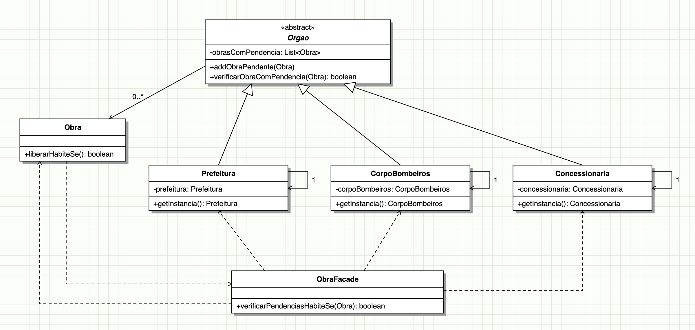

# Facade — Habite-se de Obra

Implementação do padrão de projeto **Facade**, aplicada à liberação do habite-se de uma obra: a obra pede a liberação a uma fachada, que consulta prefeitura, corpo de bombeiros e concessionária e só libera se nenhum desses órgãos tiver pendência.

## Diagrama UML



Versão editável em Mermaid: [docs/diagrama-uml.md](docs/diagrama-uml.md).

## Como rodar os testes

```
mvn test
```
